# Hi, I'm Suhrob 👋

### Mobile Developer · Kotlin Multiplatform & Compose Multiplatform

I build production Android & iOS apps from a single Kotlin codebase.

📍 Tashkent, Uzbekistan

---

## 🧑‍💻 About me

- 📱 **4+ years** in mobile — started in native Android (Kotlin, Jetpack Compose), now fully in **KMP / CMP**
- 🚀 Shipped apps live on both **Google Play and the App Store** from a shared Kotlin codebase
- 🏗️ I care about **multi-module Clean Architecture**, MVI, offline-first data layers, and type-safe navigation
- 🗣️ Uzbek · Russian · English

## 🛠️ Tech stack

**Core**

**Libraries & patterns**

Clean Architecture · MVI · Multi-module · Type-safe Navigation · Offline-first

**Services & tooling**

FCM & APNs push · Crashlytics & Analytics · Play Console · App Store Connect

## 📊 GitHub stats

  
  

---

💬 Open to interesting **KMP / CMP** projects and collaborations — say hi on [Telegram](https://t.me/suhrob_dev) or [LinkedIn](https://www.linkedin.com/in/suhrobdev/).

